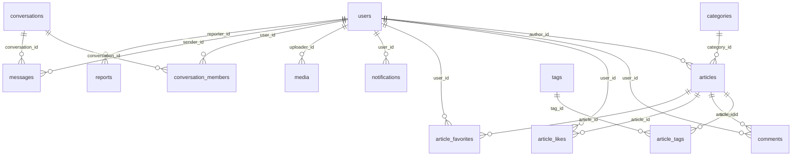

# 数据库设计文档

| 项 | 内容 |
|---|---|
| 文档版本 | v1.2 |
| 上游依据 | PRD v0.6、TECH_DESIGN v1.5 |
| 文档状态 | 待评审 |
| 更新时间 | 2026-10-21 |
| 数据库 | MySQL 8.0.36 |
| 字符集 | `utf8mb4` / `utf8mb4_0900_ai_ci` |
| 引擎 | InnoDB |

**变更记录**

| 版本 | 日期 | 变更 |
|---|---|---|
| v1.0 | 2026-10-21 | 初稿，16 张表字段级设计 |
| v1.1 | 2026-10-21 | 删除 `comments.like_count`。依据：PRD 4.1.4 的点赞仅针对文章，V1.0 无评论点赞功能。**项目尚未生成迁移脚本，直接修正初始 DDL，无需追加删除迁移**。文章点赞相关字段与索引不受影响 |
| v1.2 | 2026-10-21 | 三项调整：① conversation_members.last_read_message_id 改为 last_read_seq，新增 4.15.1 已读语义；② 新增 8.1 数据清理规则；③ articles/comments/media 三表补清理标注。未新建已读表，理由见 4.15.1 |
| v1.3 | 2026-10-21 | conversations 新增 `creator_id`（发起人）。PRD 4.1.6.1 的"每日新建会话上限 20"需要按发起人计数，原表无此列无法实现；项目尚未生成迁移脚本，直接修正初始 DDL，阶段 6 建表时同步 |

**职责边界**

- 本文档定义**表结构、字段语义、索引、约束**，是迁移脚本的唯一依据
- 业务规则（状态怎么变、谁能操作）以 PRD 为准
- 技术实现（服务分层、缓存、队列）以 TECH_DESIGN 为准
- 三者冲突时：业务规则看 PRD，字段结构看本文档，实现方式看 TECH_DESIGN

---

## 1. 设计原则

| # | 原则 | 说明 |
|---|---|---|
| 1 | 主键用 `BIGINT UNSIGNED AUTO_INCREMENT` | 聚簇索引有序插入，避免 UUID 造成的页分裂与二级索引膨胀。对外暴露用 slug，不暴露自增 ID |
| 2 | 时间统一 `DATETIME` | 不用 `TIMESTAMP`，规避 2038 与时区隐式转换 |
| 3 | 不使用外键约束 | 由应用层保证一致性。外键会让迁移顺序、批量删除、未来分库变得困难 |
| 4 | 用户表不软删 | 用 `status=2` 禁用代替。软删除与唯一索引在 MySQL 中是死结（见 9.1） |
| 5 | 内容表软删且 slug 永久占用 | 删文后 URL 返回 410，slug 不复用，防止 SEO 劫持 |
| 6 | 关联表用联合主键 | 点赞、收藏、标签关联、会话成员四类表不设自增 id，省一个二级索引 |
| 7 | 计数冗余存储 | 列表页禁止 `COUNT(*)`。计数与来源记录在同一事务内更新 |
| 8 | 状态用 `TINYINT` 不用 `ENUM` | ENUM 增加取值需要 `ALTER TABLE`，且会触发重建 |

---

## 2. 表总览

PRD 8.1 定义了 15 类业务对象，实现为 **16 张物理表**。差异仅一处：会话被拆为 `conversations`（会话本身）与 `conversation_members`（成员维度状态）。

| # | 表名 | 中文名 | 所属域 | 预估量级（V1.0） |
|---|---|---|---|---|
| 1 | `users` | 用户 | 账号 | 1 千 |
| 2 | `categories` | 分类 | 内容 | 数十 |
| 3 | `tags` | 标签 | 内容 | 数百 |
| 4 | `articles` | 文章 | 内容 | 1 万 |
| 5 | `article_tags` | 文章标签关联 | 内容 | 3 万 |
| 6 | `comments` | 评论 | 内容 | 10 万 |
| 7 | `media` | 媒体资源 | 内容 | 5 万 |
| 8 | `article_likes` | 点赞 | 互动 | 20 万 |
| 9 | `article_favorites` | 收藏 | 互动 | 10 万 |
| 10 | `notifications` | 站内通知 | 通知 | 20 万 |
| 11 | `reports` | 举报 | 治理 | 千级 |
| 12 | `operation_logs` | 操作审计 | 治理 | 5 万 |
| 13 | `settings` | 系统设置 | 配置 | 数十 |
| 14 | `conversations` | 会话 | 聊天 | 1 万 |
| 15 | `conversation_members` | 会话成员 | 聊天 | 2 万 |
| 16 | `messages` | 消息 | 聊天 | 50 万 |

> 量级为设计假设，用于索引与容量评估，不是实测数据。

---

## 3. 实体关系



**关系说明**

| 关系 | 类型 | 说明 |
|---|---|---|
| 用户 → 文章 | 1:N | 一篇文章只有一个作者 |
| 分类 → 文章 | 1:N | 一篇文章最多一个分类，`0` 表示未分类 |
| 文章 ↔ 标签 | N:N | 通过 `article_tags` 关联，单篇最多 5 个 |
| 文章 → 评论 | 1:N | 评论内部通过 `parent_id` / `root_id` 自关联为两级 |
| 用户 ↔ 文章（点赞/收藏） | N:N | 独立关联表，联合主键保证幂等 |
| 用户 ↔ 会话 | N:N | 通过 `conversation_members`，单聊固定 2 条记录 |
| 会话 → 消息 | 1:N | 消息按 `seq` 单调递增 |

---

## 4. 表结构明细

### 4.1 users 用户

```sql
CREATE TABLE `users` (
  `id`                BIGINT UNSIGNED NOT NULL AUTO_INCREMENT,
  `username`          VARCHAR(20)     NOT NULL,
  `email`             VARCHAR(128)    NOT NULL,
  `password_hash`     VARCHAR(255)    NOT NULL,
  `nickname`          VARCHAR(32)     NOT NULL DEFAULT '',
  `avatar_url`        VARCHAR(255)    NOT NULL DEFAULT '',
  `bio`               VARCHAR(255)    NOT NULL DEFAULT '',
  `role`              TINYINT UNSIGNED NOT NULL DEFAULT 1,
  `status`            TINYINT UNSIGNED NOT NULL DEFAULT 0,
  `email_verified_at` DATETIME NULL,
  `last_login_at`     DATETIME NULL,
  `last_login_ip`     VARCHAR(45) NOT NULL DEFAULT '',
  `created_at`        DATETIME NOT NULL DEFAULT CURRENT_TIMESTAMP,
  `updated_at`        DATETIME NOT NULL DEFAULT CURRENT_TIMESTAMP ON UPDATE CURRENT_TIMESTAMP,
  PRIMARY KEY (`id`),
  UNIQUE KEY `uk_username` (`username`),
  UNIQUE KEY `uk_email` (`email`),
  KEY `idx_role_status` (`role`, `status`),
  KEY `idx_created_at` (`created_at`)
) ENGINE=InnoDB DEFAULT CHARSET=utf8mb4 COLLATE=utf8mb4_0900_ai_ci COMMENT='用户';
```

| 字段 | 类型 | 空 | 默认 | 说明 |
|---|---|---|---|---|
| `id` | bigint unsigned | 否 | 自增 | 主键 |
| `username` | varchar(20) | 否 | — | 登录名，4–20 位字母/数字/下划线，注册后不可改 |
| `email` | varchar(128) | 否 | — | 登录邮箱，全局唯一，需验证 |
| `password_hash` | varchar(255) | 否 | — | argon2id 编码串，含 salt 与参数 |
| `nickname` | varchar(32) | 否 | '' | 展示名，为空时前端回退到 username |
| `avatar_url` | varchar(255) | 否 | '' | 头像 256px 版本 URL |
| `bio` | varchar(255) | 否 | '' | 个人简介 |
| `role` | tinyint unsigned | 否 | 1 | 1=reader 2=author 3=admin |
| `status` | tinyint unsigned | 否 | 0 | 0=pending_verify 1=active 2=disabled |
| `email_verified_at` | datetime | 是 | NULL | 邮箱验证通过时间 |
| `last_login_at` | datetime | 是 | NULL | 最近登录时间 |
| `last_login_ip` | varchar(45) | 否 | '' | 兼容 IPv6 |
| `created_at` | datetime | 否 | now | — |
| `updated_at` | datetime | 否 | now | 自动更新 |

**业务约束**

- `status` 默认 `0`（待验证），注册后必须验证邮箱才能登录（PRD 3.5.1）
- 不做软删除。用户注销语义由 `status=2` 承载，已发布内容保留，作者名显示为"已注销用户"
- `role` 是层级值，比较时用 `>=`，不做位运算
- 不存在 `id=0` 的用户，0 在业务中表示"无"

**索引说明**

| 索引 | 服务的查询 |
|---|---|
| `uk_username` | 登录（按用户名）、注册查重 |
| `uk_email` | 登录（按邮箱）、注册查重、找回密码 |
| `idx_role_status` | 管理端按角色/状态筛选用户 |
| `idx_created_at` | 管理端按注册时间排序 |

---

### 4.2 categories 分类

```sql
CREATE TABLE `categories` (
  `id`            BIGINT UNSIGNED NOT NULL AUTO_INCREMENT,
  `name`          VARCHAR(64)  NOT NULL,
  `slug`          VARCHAR(64)  NOT NULL,
  `description`   VARCHAR(255) NOT NULL DEFAULT '',
  `sort`          INT          NOT NULL DEFAULT 0,
  `article_count` INT UNSIGNED NOT NULL DEFAULT 0,
  `created_at`    DATETIME NOT NULL DEFAULT CURRENT_TIMESTAMP,
  `updated_at`    DATETIME NOT NULL DEFAULT CURRENT_TIMESTAMP ON UPDATE CURRENT_TIMESTAMP,
  PRIMARY KEY (`id`),
  UNIQUE KEY `uk_slug` (`slug`),
  KEY `idx_sort` (`sort`)
) ENGINE=InnoDB DEFAULT CHARSET=utf8mb4 COLLATE=utf8mb4_0900_ai_ci COMMENT='分类';
```

| 字段 | 类型 | 空 | 默认 | 说明 |
|---|---|---|---|---|
| `id` | bigint unsigned | 否 | 自增 | 从 1 开始，0 保留给"未分类" |
| `name` | varchar(64) | 否 | — | 分类名 |
| `slug` | varchar(64) | 否 | — | URL 标识，唯一 |
| `description` | varchar(255) | 否 | '' | 分类描述 |
| `sort` | int | 否 | 0 | 越小越靠前 |
| `article_count` | int unsigned | 否 | 0 | **只统计 `status=2` 的文章** |

**业务约束**

- 计数规则见 TECH_DESIGN 7.4.2：状态进入 `published` 时 +1，离开时 -1
- 删除分类前必须同事务把其下文章 `category_id` 置 0
- 计数可全量重算（管理端入口），不依赖增量正确性

---

### 4.3 tags 标签

```sql
CREATE TABLE `tags` (
  `id`            BIGINT UNSIGNED NOT NULL AUTO_INCREMENT,
  `name`          VARCHAR(32)  NOT NULL,
  `slug`          VARCHAR(32)  NOT NULL,
  `article_count` INT UNSIGNED NOT NULL DEFAULT 0,
  `created_at`    DATETIME NOT NULL DEFAULT CURRENT_TIMESTAMP,
  PRIMARY KEY (`id`),
  UNIQUE KEY `uk_slug` (`slug`),
  KEY `idx_name` (`name`)
) ENGINE=InnoDB DEFAULT CHARSET=utf8mb4 COLLATE=utf8mb4_0900_ai_ci COMMENT='标签';
```

| 字段 | 类型 | 空 | 默认 | 说明 |
|---|---|---|---|---|
| `id` | bigint unsigned | 否 | 自增 | — |
| `name` | varchar(32) | 否 | — | 标签名，允许中文 |
| `slug` | varchar(32) | 否 | — | URL 标识，需转拼音或 hash |
| `article_count` | int unsigned | 否 | 0 | 只统计 `status=2` 的文章 |

**业务约束**

- 单篇文章最多关联 5 个标签（应用层校验）
- 标签合并时：把 `article_tags` 中旧 `tag_id` 改为新 `tag_id`，冲突行忽略，然后重算计数

---

### 4.4 articles 文章

```sql
CREATE TABLE `articles` (
  `id`                 BIGINT UNSIGNED NOT NULL AUTO_INCREMENT,
  `author_id`          BIGINT UNSIGNED NOT NULL,
  `category_id`        BIGINT UNSIGNED NOT NULL DEFAULT 0,
  `title`              VARCHAR(200)  NOT NULL,
  `slug`               VARCHAR(200)  NOT NULL,
  `summary`            VARCHAR(512)  NOT NULL DEFAULT '',
  `content_md`         MEDIUMTEXT    NOT NULL,
  `content_html`       MEDIUMTEXT    NULL,
  `cover_url`          VARCHAR(255)  NOT NULL DEFAULT '',
  `status`             TINYINT UNSIGNED NOT NULL DEFAULT 0,
  `is_top`             TINYINT UNSIGNED NOT NULL DEFAULT 0,
  `allow_comment`      TINYINT UNSIGNED NOT NULL DEFAULT 1,
  `view_count`         BIGINT UNSIGNED NOT NULL DEFAULT 0,
  `like_count`         INT UNSIGNED NOT NULL DEFAULT 0,
  `favorite_count`     INT UNSIGNED NOT NULL DEFAULT 0,
  `comment_count`      INT UNSIGNED NOT NULL DEFAULT 0,
  `word_count`         INT UNSIGNED NOT NULL DEFAULT 0,
  `reading_time`       INT UNSIGNED NOT NULL DEFAULT 0,
  `version`            INT UNSIGNED NOT NULL DEFAULT 0,
  `search_sync_status` TINYINT UNSIGNED NOT NULL DEFAULT 0,
  `search_synced_at`   DATETIME NULL,
  `reject_reason`      VARCHAR(255) NOT NULL DEFAULT '',
  `offline_reason`     VARCHAR(255) NOT NULL DEFAULT '',
  `published_at`       DATETIME NULL,
  `created_at`         DATETIME NOT NULL DEFAULT CURRENT_TIMESTAMP,
  `updated_at`         DATETIME NOT NULL DEFAULT CURRENT_TIMESTAMP ON UPDATE CURRENT_TIMESTAMP,
  `deleted_at`         DATETIME NULL,
  PRIMARY KEY (`id`),
  UNIQUE KEY `uk_slug` (`slug`),
  KEY `idx_status_top_published` (`status`, `is_top`, `published_at`),
  KEY `idx_author_status` (`author_id`, `status`, `updated_at`),
  KEY `idx_category_status` (`category_id`, `status`, `published_at`),
  KEY `idx_sync_scan` (`search_sync_status`, `updated_at`),
  KEY `idx_updated_at` (`updated_at`)
) ENGINE=InnoDB DEFAULT CHARSET=utf8mb4 COLLATE=utf8mb4_0900_ai_ci COMMENT='文章';
```

| 字段 | 类型 | 空 | 默认 | 说明 |
|---|---|---|---|---|
| `id` | bigint unsigned | 否 | 自增 | — |
| `author_id` | bigint unsigned | 否 | — | 作者，创建后不可变 |
| `category_id` | bigint unsigned | 否 | 0 | **0 表示未分类**，不指向任何分类记录 |
| `title` | varchar(200) | 否 | — | 标题 |
| `slug` | varchar(200) | 否 | — | URL 标识，全局唯一，删除后永久占用 |
| `summary` | varchar(512) | 否 | '' | 摘要，空则取正文前 200 字 |
| `content_md` | mediumtext | 否 | — | **Markdown 原文，唯一事实源** |
| `content_html` | mediumtext | 是 | NULL | 渲染产物，列表查询不读取 |
| `cover_url` | varchar(255) | 否 | '' | 封面图 URL |
| `status` | tinyint unsigned | 否 | 0 | 见 5.1 |
| `is_top` | tinyint unsigned | 否 | 0 | 置顶标记 |
| `allow_comment` | tinyint unsigned | 否 | 1 | 是否允许评论 |
| `view_count` | bigint unsigned | 否 | 0 | 浏览量，Redis 缓冲后回写 |
| `like_count` | int unsigned | 否 | 0 | 点赞数，事务内直写 |
| `favorite_count` | int unsigned | 否 | 0 | 收藏数 |
| `comment_count` | int unsigned | 否 | 0 | **只统计 `approved` 的评论** |
| `word_count` | int unsigned | 否 | 0 | 正文字数 |
| `reading_time` | int unsigned | 否 | 0 | 预估阅读分钟数 |
| `version` | int unsigned | 否 | 0 | 乐观锁，每次写入 +1 |
| `search_sync_status` | tinyint unsigned | 否 | 0 | 0=待同步 1=已同步 2=失败 |
| `search_synced_at` | datetime | 是 | NULL | 最近一次成功同步时间 |
| `reject_reason` | varchar(255) | 否 | '' | 审核拒绝理由，管理员填写 |
| `offline_reason` | varchar(255) | 否 | '' | 下架理由 |
| `published_at` | datetime | 是 | NULL | **首次发布时间**，编辑不更新 |
| `created_at` | datetime | 否 | now | — |
| `updated_at` | datetime | 否 | now | 自动更新，任何写入都会变 |
| `deleted_at` | datetime | 是 | NULL | 软删除时间 |

**关键设计说明**

1. **`content_md` 是唯一事实源**。`content_html` 只是渲染缓存，可随时重建。V2.0 的 RAG 分词只读 `content_md`。
2. **`published_at` 只写一次**。重新发布（下架→上架）不覆盖，否则列表顺序会被历史文章打乱。
3. **`updated_at` 由 MySQL 自动更新**，但批量更新计数时需要显式避免触发（`UPDATE ... SET like_count=? ` 也会触发 `ON UPDATE`）。这会导致对账任务误判"内容已变更"。**因此计数更新必须加 `, updated_at = updated_at`**，保持原值。
4. **`slug` 唯一且不复用**。删除后建同 slug 文章会返回 409。
5. **物理清理**：`deleted_at` 超过保留期后由 `cleanup:article` 物理删除，条件与依赖见 8.1。清理前该行持续占用 slug。

**索引说明**

| 索引 | 服务的查询 |
|---|---|
| `uk_slug` | 详情页按 slug 查询、slug 查重 |
| `idx_status_top_published` | 首页列表：`WHERE status=2 ORDER BY is_top DESC, published_at DESC` |
| `idx_author_status` | 我的文章：`WHERE author_id=? AND status=? ORDER BY updated_at DESC` |
| `idx_category_status` | 分类页 |
| `idx_sync_scan` | 对账任务：`WHERE search_sync_status != 1 OR search_synced_at < updated_at` |
| `idx_updated_at` | 增量扫描、后台按更新时间排序 |

**不建的索引**

- `content_md` 全文索引：MySQL ngram 检索质量不足，检索走 Meilisearch
- `title` 单独索引：标题搜索由 Meilisearch 承担

---

### 4.5 article_tags 文章标签关联

```sql
CREATE TABLE `article_tags` (
  `article_id` BIGINT UNSIGNED NOT NULL,
  `tag_id`     BIGINT UNSIGNED NOT NULL,
  PRIMARY KEY (`article_id`, `tag_id`),
  KEY `idx_tag` (`tag_id`, `article_id`)
) ENGINE=InnoDB DEFAULT CHARSET=utf8mb4 COLLATE=utf8mb4_0900_ai_ci COMMENT='文章标签关联';
```

| 字段 | 类型 | 空 | 说明 |
|---|---|---|---|
| `article_id` | bigint unsigned | 否 | 联合主键之一 |
| `tag_id` | bigint unsigned | 否 | 联合主键之二 |

- 联合主键保证"同一文章不能重复绑定同一标签"
- `idx_tag` 服务"按标签查文章列表"
- 无时间字段：关联关系不需要审计，重建成本为零

---

### 4.6 comments 评论

```sql
CREATE TABLE `comments` (
  `id`               BIGINT UNSIGNED NOT NULL AUTO_INCREMENT,
  `article_id`       BIGINT UNSIGNED NOT NULL,
  `user_id`          BIGINT UNSIGNED NOT NULL,
  `parent_id`        BIGINT UNSIGNED NOT NULL DEFAULT 0,
  `root_id`          BIGINT UNSIGNED NOT NULL DEFAULT 0,
  `reply_to_user_id` BIGINT UNSIGNED NOT NULL DEFAULT 0,
  `content`          VARCHAR(1000) NOT NULL,
  `status`           TINYINT UNSIGNED NOT NULL DEFAULT 0,
  `ip`               VARCHAR(45)  NOT NULL DEFAULT '',
  `user_agent`       VARCHAR(255) NOT NULL DEFAULT '',
  `created_at`       DATETIME NOT NULL DEFAULT CURRENT_TIMESTAMP,
  `deleted_at`       DATETIME NULL,
  PRIMARY KEY (`id`),
  KEY `idx_article_status_root` (`article_id`, `status`, `root_id`, `created_at`),
  KEY `idx_user_created` (`user_id`, `created_at`),
  KEY `idx_status_created` (`status`, `created_at`)
) ENGINE=InnoDB DEFAULT CHARSET=utf8mb4 COLLATE=utf8mb4_0900_ai_ci COMMENT='评论';
```

| 字段 | 类型 | 空 | 默认 | 说明 |
|---|---|---|---|---|
| `id` | bigint unsigned | 否 | 自增 | — |
| `article_id` | bigint unsigned | 否 | — | 所属文章 |
| `user_id` | bigint unsigned | 否 | — | 评论者 |
| `parent_id` | bigint unsigned | 否 | 0 | 直接父评论，0=主楼 |
| `root_id` | bigint unsigned | 否 | 0 | 所属主楼 ID；主楼自身为 0 |
| `reply_to_user_id` | bigint unsigned | 否 | 0 | 被回复人，用于渲染"回复 @某人" |
| `content` | varchar(1000) | 否 | — | 纯文本，不允许 HTML/Markdown 原文 |
| `status` | tinyint unsigned | 否 | **0** | 0=pending 1=approved 2=rejected 3=deleted |
| `ip` | varchar(45) | 否 | '' | 评论来源 IP，用于风控 |
| `user_agent` | varchar(255) | 否 | '' | 来源 UA |
| `created_at` | datetime | 否 | now | — |
| `deleted_at` | datetime | 是 | NULL | 软删除时间 |

**关键设计说明**

1. **`status` 默认 `0`（pending）是安全默认值**。审核关闭时应用层显式写 `1`。默认值绝不能是 `1`——任何遗漏参数的下场都是内容直接公开。
2. **两级结构靠 `root_id`**。查整栋楼：`WHERE article_id=? AND root_id=? ORDER BY created_at`。不做无限级嵌套。
3. **主楼删除级联**：主楼 `status=3` 时，其下所有 `root_id=主楼id` 的回复同事务置为 `3`，并递减 `comment_count`。

> **V1.0 不含评论点赞**（PRD 4.1.4 的点赞仅针对文章）。`comments` 表不设 `like_count` 字段，避免出现"有列无功能"的遗留设计。

> **物理清理**：`status=3` 且 `deleted_at` 超过保留期的记录由 `cleanup:comment` 删除。**回复必须先于主楼删除**，否则 `root_id` 指向已消失的记录，见 8.1。

**索引说明**

| 索引 | 服务的查询 |
|---|---|
| `idx_article_status_root` | 评论区：一次拉取某文章下所有 approved 评论，按主楼分组 |
| `idx_user_created` | 个人中心"我的评论" |
| `idx_status_created` | 管理端按状态筛选待审评论 |

---

### 4.7 media 媒体资源

```sql
CREATE TABLE `media` (
  `id`            BIGINT UNSIGNED NOT NULL AUTO_INCREMENT,
  `uploader_id`   BIGINT UNSIGNED NOT NULL,
  `bucket`        VARCHAR(64)  NOT NULL,
  `object_key`    VARCHAR(512) NOT NULL,
  `original_name` VARCHAR(255) NOT NULL DEFAULT '',
  `mime_type`     VARCHAR(128) NOT NULL DEFAULT '',
  `size`          BIGINT UNSIGNED NOT NULL DEFAULT 0,
  `width`         INT UNSIGNED NOT NULL DEFAULT 0,
  `height`        INT UNSIGNED NOT NULL DEFAULT 0,
  `sha256`        CHAR(64)     NOT NULL DEFAULT '',
  `variants`      JSON NULL,
  `purpose`       VARCHAR(32)  NOT NULL DEFAULT 'article',
  `status`        TINYINT UNSIGNED NOT NULL DEFAULT 1,
  `created_at`    DATETIME NOT NULL DEFAULT CURRENT_TIMESTAMP,
  PRIMARY KEY (`id`),
  KEY `idx_uploader` (`uploader_id`, `created_at`),
  KEY `idx_sha256` (`sha256`)
) ENGINE=InnoDB DEFAULT CHARSET=utf8mb4 COLLATE=utf8mb4_0900_ai_ci COMMENT='媒体资源';
```

| 字段 | 类型 | 空 | 默认 | 说明 |
|---|---|---|---|---|
| `id` | bigint unsigned | 否 | 自增 | — |
| `uploader_id` | bigint unsigned | 否 | — | 上传者 |
| `bucket` | varchar(64) | 否 | — | `blog-public` / `blog-private` |
| `object_key` | varchar(512) | 否 | — | 存储对象路径，不含域名 |
| `original_name` | varchar(255) | 否 | '' | 原始文件名 |
| `mime_type` | varchar(128) | 否 | '' | 服务端探测的真实类型，不信任客户端 |
| `size` | bigint unsigned | 否 | 0 | 字节数 |
| `width` | int unsigned | 否 | 0 | 像素宽，解码失败为 0 |
| `height` | int unsigned | 否 | 0 | 像素高 |
| `sha256` | char(64) | 否 | '' | 内容指纹，用于秒传与去重 |
| `variants` | json | 是 | NULL | `{"w128":"key1","w256":"key2","w800":"key3"}` |
| `purpose` | varchar(32) | 否 | 'article' | avatar / article / chat |
| `status` | tinyint unsigned | 否 | 1 | 1=normal 0=deleted |
| `created_at` | datetime | 否 | now | — |

**关键设计说明**

- `purpose` 决定 bucket：`avatar` 与 `article` 进 public，`chat` 进 private（需签名 URL）
- `variants` 为 NULL 表示异步处理未完成，对账任务 `reconcile:media` 据此重试
- `sha256` 命中时直接复用已有对象，不重复上传

> **清理规则**：`status=0` 且超过保留期、且**确认无引用**的记录才可删，删除时须同时移除 MinIO 对象。引用需检查三处：文章封面、正文中的图片 key、聊天图片消息。见 8.1。

---

### 4.8 article_likes 点赞

```sql
CREATE TABLE `article_likes` (
  `user_id`    BIGINT UNSIGNED NOT NULL,
  `article_id` BIGINT UNSIGNED NOT NULL,
  `created_at` DATETIME NOT NULL DEFAULT CURRENT_TIMESTAMP,
  PRIMARY KEY (`user_id`, `article_id`),
  KEY `idx_article` (`article_id`, `created_at`)
) ENGINE=InnoDB DEFAULT CHARSET=utf8mb4 COLLATE=utf8mb4_0900_ai_ci COMMENT='文章点赞';
```

- 联合主键即幂等保证：重复点赞撞主键，`INSERT IGNORE` 返回 `affectedRows=0`
- `idx_article` 服务"这篇文章有哪些人点赞"与计数校验
- 硬删除，不软删

---

### 4.9 article_favorites 收藏

```sql
CREATE TABLE `article_favorites` (
  `user_id`    BIGINT UNSIGNED NOT NULL,
  `article_id` BIGINT UNSIGNED NOT NULL,
  `created_at` DATETIME NOT NULL DEFAULT CURRENT_TIMESTAMP,
  PRIMARY KEY (`user_id`, `article_id`),
  KEY `idx_article` (`article_id`, `created_at`),
  KEY `idx_user_created` (`user_id`, `created_at`)
) ENGINE=InnoDB DEFAULT CHARSET=utf8mb4 COLLATE=utf8mb4_0900_ai_ci COMMENT='文章收藏';
```

比点赞多一个 `idx_user_created`：收藏夹需要按收藏时间倒序分页。

---

### 4.10 notifications 站内通知

```sql
CREATE TABLE `notifications` (
  `id`         BIGINT UNSIGNED NOT NULL AUTO_INCREMENT,
  `user_id`    BIGINT UNSIGNED NOT NULL,
  `type`       VARCHAR(32) NOT NULL,
  `title`      VARCHAR(128) NOT NULL DEFAULT '',
  `content`    VARCHAR(512) NOT NULL DEFAULT '',
  `link`       VARCHAR(255) NOT NULL DEFAULT '',
  `ref_id`     BIGINT UNSIGNED NULL DEFAULT NULL,
  `is_read`    TINYINT UNSIGNED NOT NULL DEFAULT 0,
  `created_at` DATETIME NOT NULL DEFAULT CURRENT_TIMESTAMP,
  PRIMARY KEY (`id`),
  UNIQUE KEY `uk_user_type_ref` (`user_id`, `type`, `ref_id`),
  KEY `idx_user_read_created` (`user_id`, `is_read`, `created_at`)
) ENGINE=InnoDB DEFAULT CHARSET=utf8mb4 COLLATE=utf8mb4_0900_ai_ci COMMENT='站内通知';
```

| 字段 | 类型 | 空 | 默认 | 说明 |
|---|---|---|---|---|
| `id` | bigint unsigned | 否 | 自增 | — |
| `user_id` | bigint unsigned | 否 | — | 接收者 |
| `type` | varchar(32) | 否 | — | 见 5.4 |
| `title` | varchar(128) | 否 | '' | 通知标题 |
| `content` | varchar(512) | 否 | '' | 通知正文 |
| `link` | varchar(255) | 否 | '' | 点击跳转路径 |
| `ref_id` | bigint unsigned | **是** | NULL | 关联对象 ID（评论/文章），`system` 类为 NULL |
| `is_read` | tinyint unsigned | 否 | 0 | 0=未读 1=已读 |
| `created_at` | datetime | 否 | now | — |

**为什么 `ref_id` 可为 NULL**：唯一索引 `uk_user_type_ref` 需要它。MySQL 的唯一索引允许多个 NULL，而**不允许重复的空字符串**。若 `ref_id` 用 `0` 占位，同一用户的第二条 `system` 通知就会撞键失败。

**唯一键的作用**：`notification:create` 任务重复执行时用 `INSERT IGNORE` 天然幂等，这是任务幂等的实现基础（TECH_DESIGN 10.7）。

---

### 4.11 reports 举报

```sql
CREATE TABLE `reports` (
  `id`           BIGINT UNSIGNED NOT NULL AUTO_INCREMENT,
  `reporter_id`  BIGINT UNSIGNED NOT NULL,
  `target_type`  VARCHAR(32) NOT NULL,
  `target_id`    BIGINT UNSIGNED NOT NULL,
  `reason`       VARCHAR(64) NOT NULL,
  `detail`       VARCHAR(512) NOT NULL DEFAULT '',
  `status`       TINYINT UNSIGNED NOT NULL DEFAULT 0,
  `handler_id`   BIGINT UNSIGNED NOT NULL DEFAULT 0,
  `handled_at`   DATETIME NULL,
  `handle_note`  VARCHAR(255) NOT NULL DEFAULT '',
  `created_at`   DATETIME NOT NULL DEFAULT CURRENT_TIMESTAMP,
  PRIMARY KEY (`id`),
  UNIQUE KEY `uk_reporter_target` (`reporter_id`, `target_type`, `target_id`),
  KEY `idx_status_created` (`status`, `created_at`),
  KEY `idx_target` (`target_type`, `target_id`)
) ENGINE=InnoDB DEFAULT CHARSET=utf8mb4 COLLATE=utf8mb4_0900_ai_ci COMMENT='举报';
```

| 字段 | 类型 | 空 | 默认 | 说明 |
|---|---|---|---|---|
| `target_type` | varchar(32) | 否 | — | article / comment / message / conversation |
| `reason` | varchar(64) | 否 | — | 预设枚举：spam / abuse / porn / illegal / other |
| `status` | tinyint unsigned | 否 | 0 | 0=待处理 1=已受理 2=已驳回 |
| `handler_id` | bigint unsigned | 否 | 0 | 处理人，未处理为 0 |

**约束**：`uk_reporter_target` 防止同一用户重复举报同一对象（否则管理端队列会被刷爆）。

---

### 4.12 operation_logs 操作审计

```sql
CREATE TABLE `operation_logs` (
  `id`          BIGINT UNSIGNED NOT NULL AUTO_INCREMENT,
  `operator_id` BIGINT UNSIGNED NOT NULL,
  `action`      VARCHAR(64) NOT NULL,
  `target_type` VARCHAR(32) NOT NULL,
  `target_id`   BIGINT UNSIGNED NOT NULL DEFAULT 0,
  `detail`      JSON NULL,
  `ip`          VARCHAR(45) NOT NULL DEFAULT '',
  `user_agent`  VARCHAR(255) NOT NULL DEFAULT '',
  `created_at`  DATETIME NOT NULL DEFAULT CURRENT_TIMESTAMP,
  PRIMARY KEY (`id`),
  KEY `idx_operator_created` (`operator_id`, `created_at`),
  KEY `idx_target` (`target_type`, `target_id`),
  KEY `idx_action_created` (`action`, `created_at`)
) ENGINE=InnoDB DEFAULT CHARSET=utf8mb4 COLLATE=utf8mb4_0900_ai_ci COMMENT='操作审计日志';
```

**必须记录的 action**（PRD 6.2 安全底线）：

| action | 触发场景 | `detail` 内容 |
|---|---|---|
| `article.delete` | 删除文章 | `{before_status, reason}` |
| `article.offline` | 下架文章 | `{reason}` |
| `article.approve` | 审核通过 | `{from_status}` |
| `article.reject` | 审核拒绝 | `{reason}` |
| `comment.delete` | 删除评论 | `{article_id, comment_user_id}` |
| `user.disable` | 禁用用户 | `{reason}` |
| `user.enable` | 启用用户 | `{}` |
| `user.role_change` | 调整角色 | `{from_role, to_role}` |
| `report.handle` | 处理举报 | `{result, note}` |
| `settings.update` | 修改系统设置 | `{changed_keys}` |

**不记录**：普通浏览、点赞、收藏等高频低风险操作（会撑爆表）。

---

### 4.13 settings 系统设置

```sql
CREATE TABLE `settings` (
  `config_key`   VARCHAR(64) NOT NULL,
  `config_value` TEXT NOT NULL,
  `value_type`   VARCHAR(16) NOT NULL DEFAULT 'string',
  `config_group` VARCHAR(32) NOT NULL DEFAULT '',
  `description`  VARCHAR(255) NOT NULL DEFAULT '',
  `updated_at`   DATETIME NOT NULL DEFAULT CURRENT_TIMESTAMP ON UPDATE CURRENT_TIMESTAMP,
  PRIMARY KEY (`config_key`)
) ENGINE=InnoDB DEFAULT CHARSET=utf8mb4 COLLATE=utf8mb4_0900_ai_ci COMMENT='系统设置';
```

| `config_key` | 类型 | 默认值 | 说明 |
|---|---|---|---|
| `site.name` | string | `我的博客` | 站点名称 |
| `site.logo_url` | string | `''` | Logo 地址 |
| `site.icp` | string | `''` | 备案号 |
| `site.description` | string | `''` | 站点描述，用于 SEO |
| `review.article` | bool | `false` | 文章审核开关（PRD 3.4 默认关） |
| `review.comment` | bool | `true` | 评论审核开关（默认开） |
| `review.register` | bool | `false` | 注册审核开关 |
| `comment.enabled` | bool | `true` | 全站评论总开关 |
| `register.enabled` | bool | `true` | 是否开放注册 |

**约定**

- 主键是 `config_key`，不用自增 id——配置是"按键取值"，不需要代理主键
- 列名用 `config_*` 前缀，**不能用 `key` / `group`**，二者是 MySQL 保留字
- 运行时以本表为准，配置文件中的 `feature.*` 只作为初始种子

---

### 4.14 conversations 会话

```sql
CREATE TABLE `conversations` (
  `id`                   BIGINT UNSIGNED NOT NULL AUTO_INCREMENT,
  `type`                 TINYINT UNSIGNED NOT NULL DEFAULT 1,
  `conversation_key`     VARCHAR(64) NOT NULL,
  `creator_id`           BIGINT UNSIGNED NOT NULL DEFAULT 0 COMMENT '发起人：每日新建会话上限按此计数（PRD 4.1.6.1）',
  `last_message_id`      BIGINT UNSIGNED NOT NULL DEFAULT 0,
  `last_message_at`      DATETIME NULL,
  `last_message_preview` VARCHAR(128) NOT NULL DEFAULT '',
  `message_count`        INT UNSIGNED NOT NULL DEFAULT 0,
  `seq_counter`          BIGINT UNSIGNED NOT NULL DEFAULT 0,
  `created_at`           DATETIME NOT NULL DEFAULT CURRENT_TIMESTAMP,
  `updated_at`           DATETIME NOT NULL DEFAULT CURRENT_TIMESTAMP ON UPDATE CURRENT_TIMESTAMP,
  PRIMARY KEY (`id`),
  UNIQUE KEY `uk_conversation_key` (`conversation_key`),
  KEY `idx_last_message_at` (`last_message_at`)
) ENGINE=InnoDB DEFAULT CHARSET=utf8mb4 COLLATE=utf8mb4_0900_ai_ci COMMENT='会话';
```

| 字段 | 类型 | 空 | 默认 | 说明 |
|---|---|---|---|---|
| `type` | tinyint unsigned | 否 | 1 | 1=单聊（V1.0 仅此值） |
| `conversation_key` | varchar(64) | 否 | — | 单聊唯一键：`min(uid):max(uid)` |
| `creator_id` | bigint unsigned | 否 | 0 | 发起人用户 ID，每日新建上限按此计数 |
| `last_message_id` | bigint unsigned | 否 | 0 | 最后一条消息 ID |
| `last_message_at` | datetime | 是 | NULL | 最后消息时间，会话列表排序依据 |
| `last_message_preview` | varchar(128) | 否 | '' | 预览文本，列表页直接读，不反查消息表 |
| `message_count` | int unsigned | 否 | 0 | 消息总数 |
| `seq_counter` | bigint unsigned | 否 | 0 | **会话内 seq 分配器**，原子自增 |

**关键设计说明**

1. **`conversation_key` 去重**：A→B 与 B→A 必须落到同一会话。生成规则 `min(uid1,uid2) + ":" + max(uid1,uid2)`。
2. **`seq_counter` 是消息序号的唯一来源**。分配方式（TECH_DESIGN 11.6.2）：
   ```sql
   UPDATE conversations SET seq_counter = LAST_INSERT_ID(seq_counter + 1) WHERE id = ?;
   SELECT LAST_INSERT_ID();
   ```
   单语句原子，不依赖 Redis，事务回滚时序号一并回滚。
3. **`type` 只有单值**，保留它是为了让 V1.1 加群聊时不必 `ALTER TABLE`。成本 1 字节。
4. **`last_message_preview` 冗余**：会话列表若反查消息表，一次要打 N 次查询。

---

### 4.15 conversation_members 会话成员

```sql
CREATE TABLE `conversation_members` (
  `conversation_id`      BIGINT UNSIGNED NOT NULL,
  `user_id`              BIGINT UNSIGNED NOT NULL,
  `last_read_seq`        BIGINT UNSIGNED NOT NULL DEFAULT 0,
  `unread_count`         INT UNSIGNED NOT NULL DEFAULT 0,
  `is_muted`             TINYINT UNSIGNED NOT NULL DEFAULT 0,
  `joined_at`            DATETIME NOT NULL DEFAULT CURRENT_TIMESTAMP,
  `left_at`              DATETIME NULL,
  PRIMARY KEY (`conversation_id`, `user_id`),
  KEY `idx_user_conv` (`user_id`, `conversation_id`)
) ENGINE=InnoDB DEFAULT CHARSET=utf8mb4 COLLATE=utf8mb4_0900_ai_ci COMMENT='会话成员';
```

| 字段 | 类型 | 空 | 默认 | 说明 |
|---|---|---|---|---|
| `conversation_id` | bigint unsigned | 否 | — | 联合主键 |
| `user_id` | bigint unsigned | 否 | — | 联合主键 |
| `last_read_seq` | bigint unsigned | 否 | 0 | 已读到的最大消息序号 |
| `unread_count` | int unsigned | 否 | 0 | 冗余未读数，列表页直接读 |
| `is_muted` | tinyint unsigned | 否 | 0 | 免打扰 |
| `joined_at` | datetime | 否 | now | 加入时间 |
| `left_at` | datetime | 是 | NULL | 退出时间，NULL 表示在会话中 |

**说明**：单聊固定 2 条记录。成员状态（已读、未读、静音）天然属于"用户-会话"关系，所以独立成表而不是塞进 `conversations`。

#### 4.15.1 已读语义

**不单独建已读表。** `conversation_members` 的联合主键 `(conversation_id, user_id)` 本身就是"某人在某会话中的已读位置"，再建一张 `chat_message_reads` 会与之重复，并产生两个真相来源。

字段命名从 `last_read_message_id` 改为 `last_read_seq`：消息排序用的是 `seq`，若存 `message.id`，每次比较都要额外换算，容易出错。

| 项 | 规则 |
|---|---|
| 含义 | 该用户在该会话中已读的最大消息序号。`0` 表示一条未读 |
| 单调递增 | `UPDATE ... SET last_read_seq = ? WHERE last_read_seq < ?`，只增不减 |
| 并发更新 | 单条原子 UPDATE，不做读改写。乱序到达的旧请求被 `WHERE` 条件天然挡住，不需要锁 |
| 越界保护 | 新值不得大于 `conversations.seq_counter`，超出则截断为 `seq_counter` |
| 权限校验 | 只能更新自己的行：`WHERE conversation_id=? AND user_id=?`；且调用者必须是该会话成员，否则 50002 |
| 未读数 | `unread_count` 独立维护，标记已读时归零；可用 `seq_counter - last_read_seq` 做一致性校验 |

**`is_read` 不落库，也不逐条返回**

消息表没有 `is_read` 列，因为"已读"是相对观察者的状态，不是消息属性：

| 观察者 | 判定公式 |
|---|---|
| 我发出的消息 | `message.seq <= 对方的 last_read_seq` → 对方已读 |
| 对方发出的消息 | `message.seq <= 我的 last_read_seq` → 我已读 |
| 自己发给自己 | 恒为已读，不产生回执 |

接口只返回 `peer_last_read_seq`，前端按公式自行比较。**不逐条下发 `is_read`**：一次 30 条会让响应体积翻倍，且该状态随对方操作实时变化，缓存在客户端反而容易过期。

---

### 4.16 messages 消息

```sql
CREATE TABLE `messages` (
  `id`              BIGINT UNSIGNED NOT NULL AUTO_INCREMENT,
  `conversation_id` BIGINT UNSIGNED NOT NULL,
  `sender_id`       BIGINT UNSIGNED NOT NULL,
  `seq`             BIGINT UNSIGNED NOT NULL,
  `type`            TINYINT UNSIGNED NOT NULL DEFAULT 1,
  `content`         TEXT NOT NULL,
  `client_msg_id`   VARCHAR(64) NULL,
  `status`          TINYINT UNSIGNED NOT NULL DEFAULT 1,
  `created_at`      DATETIME NOT NULL DEFAULT CURRENT_TIMESTAMP,
  PRIMARY KEY (`id`),
  UNIQUE KEY `uk_sender_client` (`sender_id`, `client_msg_id`),
  UNIQUE KEY `uk_conv_seq` (`conversation_id`, `seq`),
  KEY `idx_conv_id` (`conversation_id`, `id`)
) ENGINE=InnoDB DEFAULT CHARSET=utf8mb4 COLLATE=utf8mb4_0900_ai_ci COMMENT='聊天消息';
```

| 字段 | 类型 | 空 | 默认 | 说明 |
|---|---|---|---|---|
| `id` | bigint unsigned | 否 | 自增 | 全局自增，**不保证会话内有序** |
| `conversation_id` | bigint unsigned | 否 | — | 所属会话 |
| `sender_id` | bigint unsigned | 否 | — | 发送者 |
| `seq` | bigint unsigned | 否 | — | 会话内序号，**排序与补齐的唯一依据** |
| `type` | tinyint unsigned | 否 | 1 | 1=text 2=image 3=system |
| `content` | text | 否 | — | 文本内容；图片消息存 `media` 的 object_key |
| `client_msg_id` | varchar(64) | **是** | NULL | 客户端幂等键，系统消息为 NULL |
| `status` | tinyint unsigned | 否 | 1 | 1=normal 2=recalled 3=deleted |
| `created_at` | datetime | 否 | now | — |

**关键设计说明**

1. **`seq` 而不是 `id` 排序**：`id` 是全局自增，多实例并发写入时提交顺序与 id 顺序可能不一致。
2. **`client_msg_id` 必须可空**：唯一索引 `uk_sender_client` 若用 `''` 占位，同一用户发的所有系统消息会撞键。
3. **`uk_conv_seq` 是最后一道防线**：任何原因造成的 seq 重复都会被数据库拒绝。
4. **图片消息的 `content` 存 object_key，不存完整 URL**：域名或签名策略变更时无需改数据。

---

## 5. 枚举字典

集中定义，避免散落在各处导致不一致。

### 5.1 article.status

| 值 | 名称 | 含义 | 公开可见 |
|---|---|---|---|
| 0 | `draft` | 草稿 | 否 |
| 1 | `pending` | 待审核 | 否 |
| 2 | `published` | 已发布 | 是 |
| 3 | `rejected` | 已拒绝 | 否 |
| 4 | `offline` | 已下架 | 否 |
| 5 | `archived` | 已归档 | 否 |
| 6 | `deleted` | 已删除 | 否（410） |

**合法转换**：见 PRD 3.2 状态转换表。任何未列出的转换都应该被 service 层拒绝。

### 5.2 user.status / user.role

| status | 含义 | 可登录 |
|---|---|---|
| 0 | pending_verify | 否 |
| 1 | active | 是 |
| 2 | disabled | 否 |

| role | 含义 | 层级 |
|---|---|---|
| 1 | reader | 1 |
| 2 | author | 2 |
| 3 | admin | 3 |

### 5.3 comment.status

| 值 | 含义 | 公开可见 |
|---|---|---|
| 0 | pending | 否 |
| 1 | approved | 是 |
| 2 | rejected | 否 |
| 3 | deleted | 否（占位显示） |

### 5.4 notification.type

| 值 | 触发场景 | `ref_id` |
|---|---|---|
| `comment_reply` | 有人回复我的评论 | 评论 ID |
| `comment_approved` | 我的评论通过审核 | 评论 ID |
| `article_approved` | 我的文章通过审核 | 文章 ID |
| `article_rejected` | 我的文章被拒绝 | 文章 ID |
| `article_offline` | 我的文章被下架 | 文章 ID |
| `system` | 系统公告 | NULL |

### 5.5 search_sync_status

| 值 | 含义 |
|---|---|
| 0 | 待同步（事务内写入） |
| 1 | 已同步 |
| 2 | 同步失败，需人工介入 |

---

## 6. 索引与关键查询对照

| 查询场景 | SQL 形态 | 命中索引 |
|---|---|---|
| 首页列表 | `WHERE status=2 ORDER BY is_top DESC, published_at DESC LIMIT ?` | `idx_status_top_published` |
| 分类页 | `WHERE category_id=? AND status=2 ORDER BY published_at DESC` | `idx_category_status` |
| 标签页 | `JOIN article_tags ON ... WHERE tag_id=?` | `idx_tag` |
| 我的文章 | `WHERE author_id=? AND status=? ORDER BY updated_at DESC` | `idx_author_status` |
| 文章详情 | `WHERE slug=?` | `uk_slug` |
| 评论区 | `WHERE article_id=? AND status=1 AND root_id=? ORDER BY created_at` | `idx_article_status_root` |
| 待审评论 | `WHERE status=0 ORDER BY created_at` | `idx_status_created` |
| 我是否点过赞 | `WHERE user_id=? AND article_id=?` | 主键 |
| 收藏夹 | `WHERE user_id=? ORDER BY created_at DESC` | `idx_user_created` |
| 未读通知数 | `WHERE user_id=? AND is_read=0` | `idx_user_read_created` |
| 索引对账 | `WHERE search_sync_status!=1 OR search_synced_at<updated_at LIMIT 200` | `idx_sync_scan` |
| 会话列表 | `JOIN conversation_members WHERE user_id=? ORDER BY last_message_at DESC` | `idx_user_conv` + `idx_last_message_at` |
| 历史消息 | `WHERE conversation_id=? ORDER BY id DESC LIMIT ?` | `idx_conv_id` |
| 断线补齐 | `WHERE conversation_id=? AND seq>? ORDER BY seq` | `uk_conv_seq` |

**分页约定**：统一游标分页，禁止 `OFFSET`。文章列表用 `(is_top, published_at, id)` 游标，消息用 `id` 游标，评论用 `created_at, id` 游标。

---

## 7. 迁移策略

### 7.1 工具与目录

使用 `golang-migrate`，**禁用 GORM `AutoMigrate`**。

```
migrations/
  000001_init_schema.up.sql
  000001_init_schema.down.sql
  000002_seed_admin.up.sql
  000002_seed_admin.down.sql
  ...
```

命名规范：`{6位序号}_{动词}_{对象}.{up|down}.sql`。

### 7.2 执行方式

**不在应用启动时自动迁移**。多实例同时启动会并发抢锁，失败也无法回滚。

```bash
migrate -path ./migrations -database "$DSN" up
```

应用启动时只校验版本号，不一致则拒绝启动并打印当前版本与期望版本。

### 7.3 变更纪律

| 操作 | 要求 |
|---|---|
| 加列 | 必须 `NULL` 或带默认值，保证旧代码可继续运行 |
| 改列类型 | 单独一个迁移，不与业务变更混在一起 |
| 删列 | 先停止读写（一个版本）→ 再删除（下一个版本） |
| 加索引 | 大表用 `ALGORITHM=INPLACE, LOCK=NONE`，先在从库或预发验证 |
| 改语义 | 加新列 → 双写 → 灰度读 → 停写旧列 → 删 |

**每个 `up` 必须有对应的 `down`**。无法回滚的变更（如删列）需要在文件头用注释说明"不可逆"。

### 7.4 种子数据

| 内容 | 说明 |
|---|---|
| 初始管理员 | 用户名 `admin`，密码从环境变量读取，首次登录强制修改 |
| 默认分类 | 「技术」「生活」「随笔」三条 |
| 默认设置 | `settings` 表 9 条初始配置（见 4.13） |

种子数据用独立迁移文件，不混在 `init_schema` 里。

---

## 8. 容量与性能注意

| 项 | 说明 |
|---|---|
| `content_md` / `content_html` | MEDIUMTEXT 单条上限 16MB。正文超过 200KB 时考虑拆表，V1.0 不做 |
| 列表查询禁止 `SELECT *` | 必须显式列出字段，绝不带 `content_*` |
| 计数字段更新 | 加 `, updated_at = updated_at`，避免触发 `ON UPDATE` 导致对账误判 |
| 大表 | `messages`、`notifications`、`article_likes` 是增长最快的三张表，按 12 个月评估是否需要归档 |
| 归档策略 | V1.0 不做分区与归档。超过 500 万行再评估按时间分区 |
| 备份 | 每日全量 + binlog 增量，保留 7 天，**必须有恢复演练记录**（PRD 6.2） |

### 8.1 数据清理规则

对应 PRD 6.7 与 TECH_DESIGN 10.9。**期限待决策（R1–R6），本节只定义清理条件与依赖顺序。**

| 表 | 清理标记 | 物理删除条件 | 前置检查 |
|---|---|---|---|
| `articles` | `deleted_at IS NOT NULL` | `deleted_at < NOW() - INTERVAL R1 DAY` | 无；删除后必须移除搜索索引 |
| `comments` | `status = 3` | `deleted_at < NOW() - INTERVAL R2 DAY` | 回复先于主楼删除；删后重算 `comment_count` |
| `messages` | `status = 3` | `created_at < NOW() - INTERVAL R3 DAY` | **不删会话最后一条消息**（`conversations.last_message_id` 指向它） |
| `notifications` | 无软删 | `created_at < NOW() - INTERVAL R4 DAY` | 无 |
| `media` | `status = 0` | `created_at < NOW() - INTERVAL R6 DAY` **且** 无引用 | 需查文章封面、正文图片 key、聊天图片消息 |
| `users` | `status = 2`（禁用） | **不做物理删除** | 内容归属需要，永久保留 |
| `operation_logs` | 无软删 | R5 待决策 | 不与业务数据同批清理 |

**执行顺序（不可颠倒）**

```
1. articles / comments / messages  → 删数据库记录
2. 同步移除搜索索引
3. 重算受影响文章的 comment_count
4. media 确认无引用后 → 删除 MinIO 对象
```

先删对象后删记录，会留下"记录指向不存在的文件"，前端直接破图。

**三个容易踩的坑**

1. **`media` 的引用检查必须查三处**：文章封面、`content_md` 中的图片 key、聊天图片消息。只查 `media` 表本身没有任何意义
2. **评论不能一刀切**：主楼与其回复的 `deleted_at` 不同，必须先删回复再删主楼，否则 `root_id` 指向已消失的记录
3. **`messages` 不能删会话最后一条**：否则 `conversations.last_message_preview` 与 `message_count` 失去依据

**明确不做**

- 不做分区表、不做归档库（超出 V1.0 范围）
- 不依据"法律合规"设定期限——期限未定，工程侧不预设结论，不声称已满足任何法规要求

---

## 9. 已知限制与陷阱

### 9.1 软删除与唯一索引

MySQL 的唯一索引中 `NULL` 不参与唯一性判定，因此：

```sql
-- 错误做法：允许多行相同 username 且 deleted_at 为 NULL
UNIQUE KEY uk_username_deleted (username, deleted_at)
```

**本文档的处理**：用户表干脆不做软删除（用 `status`）；文章表的 slug 软删后永久占用，唯一索引保持单列。

### 9.2 计数漂移

`categories.article_count`、`tags.article_count`、`articles.comment_count`、`articles.like_count`、`articles.favorite_count` 都是冗余字段，任何遗漏的更新路径都会造成漂移。

**处理**：所有计数变更收口到单一函数（TECH_DESIGN 7.4.2），并提供全量重算入口。

### 9.3 `type` 字段的争议

`conversations.type` 恒为 1，`messages.type` 有 3 个取值。前者是为 V1.1 群聊预留的 1 字节，后者是当前就需要的。

**判定**：前者属于"极低成本的可扩展点"，不构成"为未验证功能预建表"；后者是 V1.0 功能。

---

## 10. 与上游文档的对应

| 上游要求 | 本文档对应 | 状态 |
|---|---|---|
| PRD 8.1 的 15 类业务对象 | 16 张表（会话拆 2 张） | ✅ 已覆盖，差异已说明 |
| PRD 3.2 的 7 种文章状态 | `articles.status` 0–6 | ✅ 一致 |
| PRD 3.1 的 3 种用户状态 | `users.status` 0–2 | ✅ 一致 |
| PRD 3.3 的 4 种评论状态 | `comments.status` 0–3 | ✅ 一致，默认 pending |
| PRD 7.4 的索引同步状态 | `search_sync_status` + `search_synced_at` | ✅ 已落地 |
| TECH_DESIGN 7.2 的 DDL | 本文档第 4 章 | ✅ 字段级一致 |
| TECH_DESIGN 7.4 的计数规则 | 本文档 4.2 / 4.3 / 6 章 | ✅ 已覆盖 |

**未纳入本文档的内容**：迁移脚本 SQL 全文、种子数据明细、备份脚本。这些在实现阶段随代码产出。
